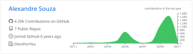
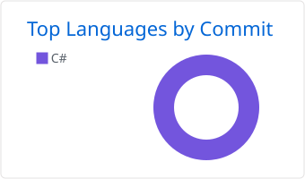
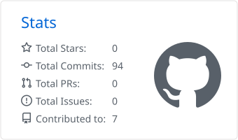

<picture>
  <source media="(min-width: 481px)" srcset="./assets/profile-visual.svg" />
  
</picture>

# Alexandre Souza

**Software Architect · Senior Software Engineer · AI Engineer**

**.NET · Distributed Systems · Cloud Architecture · AI Engineering · Digital Products**

Arquiteto de Software e Engenheiro de Software Sênior, atuo em aplicações corporativas e produtos da [DevsForYou](https://devsforyou.com.br/). Com foco em .NET e modernização, conecto decisões de arquitetura a necessidades de negócio e acompanho soluções da concepção à operação.

[LinkedIn](https://www.linkedin.com/in/alexandre-roberto-souza-software-engineer/) · [DevsForYou](https://devsforyou.com.br/) · [SportsForYou](https://sportsforyou.com.br/)

**Cases técnicos:** [WorkTime — integrações e fluxos corporativos](https://github.com/ALRSO85/worktime-showcase) · [SportsForYou — arquitetura modular](https://github.com/ALRSO85/sportsforyou-showcase) · [ReleaseHub — governança de releases](https://github.com/ALRSO85/releasehub-showcase)

**Navegação:** [Cases](#projetos-em-destaque) · [Outros produtos](#outros-produtos) · [Engenharia de IA](#engenharia-de-ia) · [Competências](#compet%C3%AAncias-t%C3%A9cnicas) · [Segurança](#seguran%C3%A7a-aplicada) · [GitHub](#github) · [Contato](#contato)

---

## Projetos em destaque

Cases que demonstram arquitetura de software, engenharia .NET, integrações e governança de releases.

### [WorkTime](https://worktime.devforyou.com.br/account/login)

Aplicação para gestão e conciliação de horas, jornadas, equipes, férias, fechamentos, auditoria e relatórios.

- **Integrações:** Businessmap/Kanbanize, com sincronização de apontamentos, e Ahgora, com importação de horas.
- **Stack:** `C#` `.NET 10` `ASP.NET Core` `EF Core` `SQL Server`
- **Infra:** `Ubuntu Server` · `Docker` · `Cloudflare Tunnel`
- [Acessar WorkTime](https://worktime.devforyou.com.br/account/login) · [Ver showcase técnico](https://github.com/ALRSO85/worktime-showcase)

---

### [SportsForYou](https://sportsforyou.com.br/)

Plataforma esportiva para atletas, organizadores, comunidades e parceiros, com eventos, perfis e integrações.

- **Engenharia:** arquitetura modular, qualidade automatizada, governança de dados, acessibilidade e SEO.
- **Stack:** `C#` `.NET 10` `ASP.NET Core` `SQL Server` `Docker`
- **Infra:** `Ubuntu Server` · `Docker` · `Cloudflare Tunnel`
- [Acessar produto](https://sportsforyou.com.br/) · [Ver showcase técnico](https://github.com/ALRSO85/sportsforyou-showcase) · [Artigo sobre arquitetura modular](https://pt.linkedin.com/pulse/arquitetura-modular-aplicada-uma-plataforma-digital-para-souza-g8btf)

---

### [ReleaseHub](https://releasehub.devforyou.com.br/)

Plataforma self-hosted para governança e execução de releases, com aprovações, validações e auditoria.

- **Engenharia:** rastreabilidade de artefatos e políticas de integridade para releases.
- **Stack:** `.NET 10` `ASP.NET Core` `Docker` `SQL Server`
- **Infra:** `Ubuntu Server` · `Docker`
- [Acessar ReleaseHub](https://releasehub.devforyou.com.br/) · [Ver showcase técnico](https://github.com/ALRSO85/releasehub-showcase)

## Outros produtos

- **[Chegou Inteiro](https://chegouinteiro.devforyou.com.br/):** plataforma para consulta regional de experiências de entrega. A instância pública é uma demonstração com dados sintéticos, sem cobertura real comprovada e com cadastros e relatos desativados. `ASP.NET Core MVC` · Hospedagem: `Ubuntu Server` · `Docker` · [Acessar demonstração](https://chegouinteiro.devforyou.com.br/)
- **[Doguinhos 220v](https://doguinhos220v.com.br/):** portal pet com artigos, eventos, vídeos e recomendações de produtos. `PHP 8.5` · `Bootstrap 5.3` · Hospedagem: `Ubuntu Server` · `Apache` · [Ver showcase técnico](https://github.com/ALRSO85/doguinhos-showcase)
### Projeto open source

**[FingerBridge](https://github.com/ALRSO85/fingerbridge)** — Biblioteca para integrar leitores biométricos a aplicações Windows em .NET Framework 4.8, com providers independentes.

`C#` `.NET Framework` `WinForms` `Biometria` · [Licença MIT](https://github.com/ALRSO85/fingerbridge/blob/main/LICENSE) · [Explorar repositório](https://github.com/ALRSO85/fingerbridge)

## Engenharia de IA

Tenho aprofundado meus estudos em engenharia de IA e explorado o uso de LLMs no desenvolvimento de software. No [showcase do SportsForYou](https://github.com/ALRSO85/sportsforyou-showcase#ai-assisted-engineering), documento aplicações em revisão de código, documentação, análise de logs e arquitetura. Também escrevi sobre [arquitetura AI-First no ecossistema .NET](https://pt.linkedin.com/pulse/ai-first-software-architecture-o-que-muda-quando-artificial-souza-mjcgf), abordando orquestração, busca semântica e guardrails.

## Competências técnicas

- **Backend e APIs:** `C#` `.NET` `ASP.NET Core` `Node.js` `APIs REST`
- **Design de software e arquitetura:** `DDD` `Clean Architecture` `Arquitetura modular` `Microsserviços` `Sistemas orientados a eventos`
- **Dados:** `SQL Server` `MySQL` `PostgreSQL` `Redis` `Entity Framework Core`
- **Web:** `HTML` `CSS` `Bootstrap` `JavaScript` `TypeScript` `Interfaces responsivas`
- **Cloud e entrega:** `Docker` `Linux` `Ubuntu Server` `Azure` `AWS` `Cloudflare DNS` `Cloudflare Tunnel` `CI/CD`
- **Segurança:** `CSRF` `Cookies seguros` `Rate limiting` `SHA-256` `SBOM` `Dados biométricos`
- **Engenharia de software:** `Modernização` `Integrações` `Desempenho` `Resiliência` `Observabilidade`

## Segurança aplicada

- **Doguinhos 220v:** senhas com bcrypt, proteção CSRF, sessões administrativas com cookies HttpOnly/SameSite, rate limiting e validação de uploads.
- **WorkTime:** ações protegidas contra CSRF, cookies de autenticação HttpOnly e políticas configuráveis de expiração, SameSite e Secure, além de rate limiting.
- **ReleaseHub:** validação de hashes SHA-256 e políticas configuráveis para exigir assinatura, proveniência e SBOM de artefatos.
- **[FingerBridge](https://github.com/ALRSO85/fingerbridge):** [política de segurança e relato privado](https://github.com/ALRSO85/fingerbridge/blob/main/SECURITY.md); orientações para não armazenar imagens biométricas nem registrar templates em logs e criptografar templates persistidos.

## Temas de interesse

Sistemas distribuídos, produtos SaaS, infraestrutura self-hosted e IA aplicada à engenharia de software.

## GitHub

Parte da minha atuação acontece em repositórios privados e ambientes corporativos. Os cards abaixo são gerados por uma GitHub Action e podem não representar toda essa atividade.

<picture>
  <source media="(max-width: 480px) and (prefers-color-scheme: dark)" srcset="./profile-summary-card-output/mobile/github_dark/0-profile-details.svg" />
  <source media="(min-width: 481px) and (prefers-color-scheme: dark)" srcset="./profile-summary-card-output/github_dark/0-profile-details.svg" />
  <source media="(min-width: 481px)" srcset="./profile-summary-card-output/github/0-profile-details.svg" />
  
</picture>

<picture>
  <source media="(prefers-color-scheme: dark)" srcset="./profile-summary-card-output/github_dark/2-most-commit-language.svg" />
  
</picture>

<picture>
  <source media="(prefers-color-scheme: dark)" srcset="./profile-summary-card-output/github_dark/3-stats.svg" />
  
</picture>

## Contato

Estou aberto a conversar sobre arquitetura, engenharia de software e produtos digitais.

- [LinkedIn](https://www.linkedin.com/in/alexandre-roberto-souza-software-engineer/)
- [DevsForYou](https://devsforyou.com.br/)
- Belo Horizonte, Minas Gerais, Brasil

  

