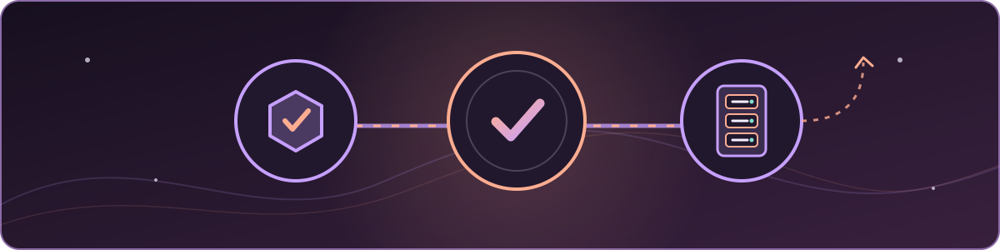

<picture>
  <source media="(prefers-reduced-motion: reduce) and (min-width: 481px)" srcset="./assets/profile-visual-cyberpunk-desktop.png" />
  <source media="(min-width: 481px)" srcset="./assets/profile-visual-cyberpunk-desktop.gif" />
  <source media="(prefers-reduced-motion: reduce)" srcset="./assets/profile-visual-cyberpunk-mobile.png" />
  
</picture>

# Suzanna Souza

**Arquiteta de Software · Engenheira de Software Sênior**

.NET · Sistemas Distribuídos · Arquitetura em Nuvem · Engenharia de IA

Na [DevsForYou](https://devsforyou.com.br/), desenho e construo WorkTime, SportsForYou e ReleaseHub, com foco em arquitetura e modernização de produtos.

[Ver projetos em destaque](#projetos-em-destaque) · [LinkedIn](https://www.linkedin.com/in/suzanna-souza-software-engineer/) · [DevsForYou](https://devsforyou.com.br/)

---

## Projetos em destaque

Três exemplos de decisões sobre integrações, processamento assíncrono e publicação de versões.

### [WorkTime](https://worktime.devforyou.com.br/)

Gestão e conciliação de horas, jornadas, equipes, férias, fechamentos, auditoria e relatórios.

- **Desafio:** o provedor pode processar uma escrita sem confirmar a resposta.
- **Abordagem:** reserva uma chave idempotente antes do envio; se o resultado é incerto, registra `Unknown` e não reenvia a operação às cegas. As retentativas automáticas ficam restritas a leituras transitórias (`GET` e `HEAD`).

**Stack:** `C#` · `.NET 10` · `ASP.NET Core` · `EF Core` · `SQL Server` · **Integrações:** Businessmap/Kanbanize · Ahgora · **Operação:** Ubuntu Server · Cloudflare Tunnel · [Documentação técnica](https://github.com/ALRSO85/worktime-showcase).

---

### [SportsForYou](https://sportsforyou.com.br/)

Calendário público para descobrir eventos esportivos por modalidade, região e período, com fontes consultadas.

[Explorar o calendário público](https://sportsforyou.com.br/eventos/calendario/) · [Conhecer o produto](https://sportsforyou.com.br/)

- **Desafio:** executar tarefas em segundo plano sem depender do ciclo de vida da aplicação web.
- **Abordagem:** o `Sport.Worker.JobCenter` roda como serviço .NET em contêiner próprio, com verificação de saúde.

**Stack:** `C#` · `.NET 10` · `ASP.NET Core` · `SQL Server` · `Docker` · **Operação:** Ubuntu Server · Cloudflare Tunnel · [Documentação técnica](https://github.com/ALRSO85/sportsforyou-showcase) · [Artigo sobre arquitetura modular](https://pt.linkedin.com/pulse/arquitetura-modular-aplicada-uma-plataforma-digital-para-souza-g8btf).

---

### [ReleaseHub](https://releasehub.devforyou.com.br/)

Plataforma de governança e execução de versões com aprovações, validações e auditoria.

- **Desafio:** uma reversão precisa atualizar o ambiente remoto e o catálogo local.
- **Abordagem:** a operação só muda de `Revertendo` para `Revertida` após as confirmações; falhas ficam registradas para reconciliação.

**Stack:** `.NET 10` · `ASP.NET Core` · `Docker` · `SQL Server` · **Operação:** Ubuntu Server · Cloudflare Tunnel · [Documentação técnica](https://github.com/ALRSO85/releasehub-showcase).

## Experimento técnico

### [Financial](https://github.com/ALRSO85/Financial) — API demonstrativa

API em C#/.NET para registrar créditos e débitos e consultar saldos atuais ou históricos.

O experimento usa um livro-razão imutável (ledger), escritas idempotentes, padrão outbox transacional e projeção de leitura assíncrona, com .NET 10, ASP.NET Core Minimal APIs, PostgreSQL, JWT e OpenTelemetry. [Explorar o código e a arquitetura](https://github.com/ALRSO85/Financial).

## Outros produtos

### [Chegou Inteiro](https://chegouinteiro.devforyou.com.br/)

Plataforma para consulta regional de experiências de entrega.

A demonstração usa dados sintéticos e está em modo de consulta; não representa cobertura real de entregas. Novos cadastros e relatos estão desativados. O projeto usa ASP.NET Core MVC, Ubuntu Server e Docker. [Abrir a demonstração](https://chegouinteiro.devforyou.com.br/) · [Ver a documentação técnica](https://github.com/ALRSO85/chegouinteiro-showcase).

### [Doguinhos 220v](https://doguinhos220v.com.br/)

Portal pet com artigos, eventos, vídeos e recomendações de produtos.

O portal foi desenvolvido pela DevsForYou com PHP 8.5 e Bootstrap 5.3, e roda em Ubuntu Server com Apache. [Acessar o portal](https://doguinhos220v.com.br/) · [Ver a documentação técnica](https://github.com/ALRSO85/doguinhos-showcase).

## Código aberto

**[FingerBridge](https://github.com/ALRSO85/fingerbridge)** — Projeto de código aberto criado e mantido por mim: biblioteca para integrar leitores biométricos a aplicações Windows em .NET Framework 4.8, com provedores independentes.

`C#` `.NET Framework` `WinForms` `Biometria` · [Licença MIT](https://github.com/ALRSO85/fingerbridge/blob/main/LICENSE) · [Explorar repositório](https://github.com/ALRSO85/fingerbridge)

## Engenharia de IA

Tenho aprofundado meus estudos em engenharia de IA, com foco em aplicações de modelos de linguagem de grande porte (LLMs) no desenvolvimento de software. No artigo sobre [arquitetura com IA desde a concepção no ecossistema .NET](https://pt.linkedin.com/pulse/ai-first-software-architecture-o-que-muda-quando-artificial-souza-mjcgf), escrevi sobre orquestração, busca semântica e mecanismos de controle.

## Competências técnicas

- **Serviços e APIs:** `C#` `.NET` `ASP.NET Core` `Node.js` `APIs REST`
- **Design de software e arquitetura:** `DDD` `Clean Architecture` `Arquitetura modular` `Microsserviços` `Sistemas orientados a eventos`
- **Dados:** `SQL Server` `MySQL` `PostgreSQL` `Redis` `Entity Framework Core`
- **Web:** `HTML` `CSS` `Bootstrap` `JavaScript` `TypeScript` `Interfaces responsivas`
- **Nuvem e entrega:** `Docker` `Linux` `Ubuntu Server` `Azure` `AWS` `Cloudflare DNS` `Cloudflare Tunnel` `CI/CD`
- **Segurança:** `CSRF` `Cookies seguros` `Limitação de requisições` `SHA-256` `SBOM` `Dados biométricos`
- **Engenharia de software:** `Modernização` `Integrações` `Desempenho` `Resiliência` `Observabilidade`
- **Qualidade e testes:** análise estática com `SonarQube` e testes de carga com `Apache JMeter`

## Segurança aplicada

- **Doguinhos 220v:** senhas com bcrypt, proteção CSRF, sessões administrativas com cookies HttpOnly/SameSite, limitação de requisições e validação de arquivos enviados.
- **WorkTime:** ações protegidas contra CSRF, cookies de autenticação HttpOnly e políticas configuráveis de expiração, SameSite e Secure, além de limitação de requisições.
- **ReleaseHub:** validação de hashes SHA-256 e políticas configuráveis para exigir assinatura, proveniência e SBOM de artefatos.
- **[FingerBridge](https://github.com/ALRSO85/fingerbridge):** [política de segurança e relato privado](https://github.com/ALRSO85/fingerbridge/blob/main/SECURITY.md); orientações para não armazenar imagens biométricas, não registrar modelos biométricos em logs e criptografar os modelos armazenados.

## Temas de interesse

Sistemas distribuídos, produtos SaaS, infraestrutura própria e IA aplicada à engenharia de software.

## GitHub

Parte da minha atuação acontece em repositórios privados e ambientes corporativos. O cartão abaixo é gerado pela [automação do GitHub](.github/workflows/profile-summary-cards.yml) e mostra a atividade que o GitHub disponibiliza para este perfil.

<picture>
  <source media="(max-width: 480px) and (prefers-color-scheme: dark)" srcset="./profile-summary-card-output/mobile/github_dark/0-profile-details.svg" />
  <source media="(min-width: 481px) and (prefers-color-scheme: dark)" srcset="./profile-summary-card-output/github_dark/0-profile-details.svg" />
  <source media="(min-width: 481px)" srcset="./profile-summary-card-output/github/0-profile-details.svg" />
  
</picture>

## Contato

Estou aberta a conversar sobre arquitetura, engenharia de software e produtos digitais.

- [LinkedIn](https://www.linkedin.com/in/suzanna-souza-software-engineer/)
- [DevsForYou](https://devsforyou.com.br/)
- Belo Horizonte, Minas Gerais, Brasil

  

